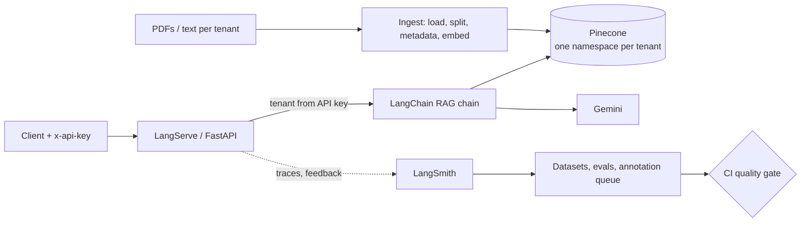

# Multi-Tenant RAG-as-a-Service (LLMOps)

A production-style RAG API where each customer's documents are isolated, answers are cited, every request is traced, and quality is measured by versioned evaluations that gate deployment.

**Stack:** LangChain (LCEL) · Pinecone · Gemini · LangServe + FastAPI · LangSmith · Docker · GitHub Actions

## Architecture



## Features

- **Multi-tenant isolation:** one Pinecone namespace per tenant. The tenant ID comes only from the API key and overwrites any client-supplied value.
- **Cited answers:** inline `[source, page X]` citations and chunk IDs in every response, with an "I don't know" fallback.
- **Observability:** every run is tagged with tenant, chain version, models, and top-k in LangSmith. A script reports cost and latency per tenant.
- **Evaluation:** a golden dataset with three evaluators (retrieval hit, faithfulness, correctness) and versioned experiments.
- **Feedback loop:** `/feedback` attaches thumbs up/down to the exact trace, with a tenant ownership check, an annotation queue, and a script to turn reviewed failures into new test examples.
- **CI/CD:** lint, tests, Docker build, and an evaluation gate that fails the build if quality drops.

## Evaluation results

| Experiment | Change | correctness | faithfulness | retrieval_hit |
|---|---|---|---|---|
| v1-k4 | baseline | 0.89 | 1.00 | 0.89 |
| v2-k4 | prompt rule: "answer completely", plus fixed evaluator | 1.00 | 1.00 | 1.00 |


**Findings**
1. One failure was a real app issue: the retriever returned the right chunk, but the model gave a partial answer. I found this by reading the retriever output in the LangSmith trace and fixed it with one prompt rule.
2. The other failure was a bug in my evaluator (the off-topic question has no expected page), not in the app.
3. Both changes landed together, so the retrieval_hit jump comes from the evaluator fix and only the correctness jump comes from the prompt.


## Quality gate

I deliberately broke the prompt ("always answer in one word") to prove the gate works. Retrieval stayed healthy while generation failed, and the build exited with code 1.


## Security

- Tenant derived server-side from the API key (constant-time comparison), never from the request.
- Namespace-per-tenant retrieval, tested by automated isolation tests.
- Feedback endpoint checks run ownership and returns the same 404 for "missing" and "not yours".
- Upload type and size limits, and path-traversal stripping on `/ingest`.
- Tests: 24 free tests plus 2 LLM prompt-injection tests.


## Run it locally

```bash
python -m pip install -r requirements-dev.txt
cp .env.example .env        # then fill in your keys
python scripts_create_index.py
python scripts_ingest_all.py
python -m app.server
```

Query it:

```bash
curl -X POST http://localhost:8000/query/invoke \
  -H "Content-Type: application/json" -H "x-api-key: $KEY_A" \
  -d '{"input": {"question": "What is this document about?"}}'
```

Docker:

```bash
docker build -t rag-saas .
docker run --rm -p 8000:8000 --env-file .env rag-saas
```

Tests and evals:

```bash
python -m pytest -v                 # free tests
python -m pytest -m llm -v          # prompt-injection tests (uses Gemini)
python -m evals.run_evals           # experiment in LangSmith
python -m evals.gate                # CI quality gate
```

## Project layout

```
app/        server, chain, ingest, auth, config
evals/      dataset, experiments, CI gate
tests/      auth, isolation, injection tests
.github/    CI workflow
```

## Limitations and next steps

- Golden set is small (11 questions) and mostly easy; only Tenant A has one.
- LangServe is in maintenance mode, so the chain could move to LangGraph.
- Planned: rate limiting, hybrid search with reranking, separate indexes per environment, semantic caching.

## Author

<Your name> · <LinkedIn or GitHub link>